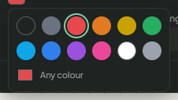

# polish — the Polish list's pure-look items

Branch `polish`, from master (87fcc55). Status: **ready**. Full suite on its own: **4453/4453 green**. One commit per item.

## The Polish list (docs/RESUME.md) and what was done

| Item | Pure look? | Done |
|---|---|---|
| The text card's colour swatches: the dark colours are almost invisible on the dark card (no ring or border) | yes | **fixed** |
| The Draw rail button uses the Blocks glyph (Icons.dc.html has no Draw icon yet) | needs a design icon | not done: icons come only from the design file, never hand-drawn |
| A selected polyline's corner squares sit on top of the box handles; there the corner drag wins | no, it changes which drag happens | not done (behaviour) |
| The floating selection bar can cover a neighbouring shape | no, it changes where the bar goes | not done (behaviour) |

## 1. Dark colour swatches ringed
In the colour popover (a text's Text colour, a shape's Stroke and Fill, from the card or the bar), a very dark colour
(the ink, #1F2321) now has the same thin `#5A615C` ring white already had. It no longer disappears into the dark
popover. `studio/Swatch.jsx` uses the existing `onDark` test, so no new colour or value was added.

Before (the ink cell, top left, is invisible) and after:

| Before | After |
|---|---|
|  |  |

Measured in the running app: the ink cell's border was 0 px before and is 1 px after; every other cell is unchanged
(white 1 px, the rest 0).

## Rule 7
No layout rule changed.

## Hand-check (≤ 6)
1. Place a text, then in its card click the Text colour swatch. The ink colour (top left) shows as a ringed dark
   circle.
2. Pick red, then reopen: the ink is still visible, and red has the green "picked" ring.
